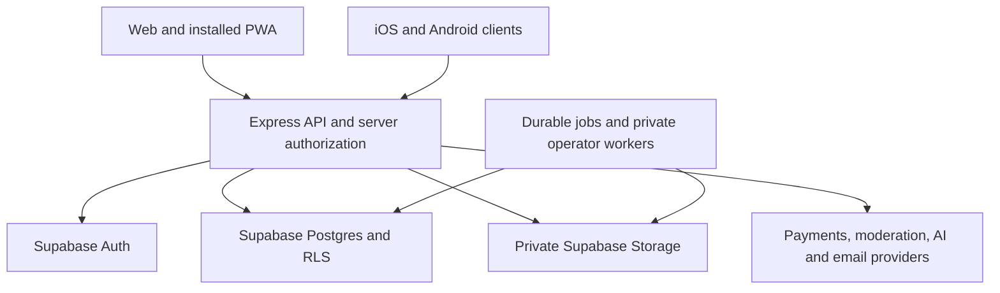

# Backend architecture and deployment roadmap

Reviewed: 22 October 2026. This is a source-based proposal, not a runtime migration
or a new security certification. No application code, database, account, DNS or
hosting configuration was changed for this review.

## Recommendation

Keep Express with Supabase for the first public web/PWA and iOS/Android release.
Deploy and harden that architecture, then consider individual function extractions
only when measurements show an operational, latency or maintenance benefit.

Supabase is already the sole runtime datastore, with Auth and private Storage.
The legacy JSON/custom-session runtime has been retired. Express currently owns
the HTTP API, session facade, relationship checks, transaction orchestration and
several operational loops. Removing it is a substantial runtime migration. It is
optional for hosting the website and for packaging mobile clients.

The source review found 268 route registration calls, expanded into 290 entries
and 288 distinct method/path patterns across 59 files. This includes aliases,
intentional chained handlers and three confirmed retired 410 guards. These are
source counts, not unique workflows or successful runtime tests. See the complete
[source inventory](migrations/express-runtime-inventory.json).

Use [ARCHITECTURE.md](../ARCHITECTURE.md) and the current top section of
[implementation status](migrations/supabase-implementation-status.md) for today's
datastore. `SUPABASE_CONTINUATION.md` contains an older 12 October checkpoint and
must not be used to infer that the JSON cutover is still pending.

## Choosing an architecture

| Option | Benefit | Cost and risk | Decision |
| --- | --- | --- | --- |
| Express + Supabase | Preserve tested workflows, transactions, native image processing and worker control; one stable API for all clients | Operate a Node runtime, monitor it, patch dependencies, budget database connections and configure reliable workers | Recommended for launch |
| Express + selected Edge Functions | Extract bounded independent workloads where measurements justify it | Two runtimes, deployments and authorization paths to maintain; risk duplicating jobs/limits | Optional after a measured pilot |
| Replace Express completely | Managed function execution and fewer API server processes to operate | Port session/security protocols, jobs and streaming; replace incompatible libraries; prove full workflow and recovery parity | Defer pending demonstrated benefit |

Runtime choice alone does not establish better security, faster requests or lower
cost. Compare the same workloads, database location and concurrency. Include cold
and warm latency, CPU, memory, external API delays, connection counts, operations
and all remaining workers in the comparison.

Current hosted Edge Functions have bounded execution resources, including CPU,
memory and wall time; native multithreaded libraries such as Sharp are explicitly
unsupported. `EdgeRuntime.waitUntil` remains subject to those limits. PineVela's
current Sharp upload processing and long-lived worker/notification behavior need
new implementations before a complete move. See
[function limits](https://supabase.com/docs/guides/functions/limits) and
[background task lifecycle](https://supabase.com/docs/guides/functions/background-tasks).

## Recommended launch path with Express retained

| Phase | Work | Evidence required to proceed |
| --- | --- | --- |
| 1. Baseline and recovery | Keep the source inventory, identify the release commit/build, review enabled versus intentionally disabled workflows, retain matching database/Storage backups and secret-key recovery material | A restore rehearsal and a documented rollback build; no deletion of existing recovery files |
| 2. Production transport | Select Node hosting and frontend delivery. Prefer a same-origin `/api` reverse proxy for the website. Configure HTTPS, exact public origin, trusted proxy addresses, secure cookies, health checks, graceful restart and provider callbacks | Real signup/OTP, password recovery, Google selection/callback, logout/relogin and portal switching work through the deployed origin |
| 3. Runtime and jobs | Deploy API and intended non-destructive jobs with durable state/leases. Keep privileged residence/wipe operators isolated and preview-only unless separately approved. Preserve the delivery-PIN key identity | Jobs recover after restart, overlapping instances do not repeat business effects, secret values stay out of frontend builds/logs |
| 4. Abuse and operational limits | Put edge request controls in front of the API, verify proxy/IP behavior, bound requests/uploads and database pools. Process-local API/AI budgets need shared enforcement before horizontally scaling | Independent-instance tests and bounded authorized load tests; existing email/login/CAPTCHA ledgers remain shared. Resolve the outstanding direct-native CAPTCHA replay behavior before public launch |
| 5. Product acceptance | Exercise real housing, staff, marketplace, payments, encrypted chat, support/moderation and account governance journeys in an isolated staging environment | Positive and forbidden operations pass across roles/accounts/hostels; concurrency/replay/restart/provider-failure checks; no real customer charges or unsolicited mail |
| 6. Domain and monitored rollout | Connect `pinevela.app` website DNS after the deployment works, preserve Resend email records, configure exact auth redirects/Turnstile hosts and verified payment callbacks | HTTPS journeys, email delivery, PWA manifest/worker scope, private-path denials, alerts and rollback tested on the actual domain |
| 7. Mobile release | Keep the web/PWA available. Build Capacitor clients against the stable HTTPS API; validate native authentication transport, secure session handling, system-browser OAuth/deep links and resume/logout behavior | Real iOS/Android device acceptance with no broad CORS or cookie-policy relaxation; app-store packaging and payment-policy review as a separate release step |

Native shell development may proceed in parallel once API contracts are stable.
Production backend reliability is the release dependency; Express removal is not.
Phone home-screen installation has already been implemented locally and still
needs physical-device acceptance on the deployed HTTPS site.

## Required behavior in either architecture

- A verified Supabase identity must resolve to a current native session and active
  PineVela account/portal binding. Preserve PIN versions, assignments, account
  bans/restrictions, administrator membership and manager operation-key checks.
- Lock and revalidate that authority inside the same database transaction as the
  operation. Preserve transaction-local verified claims and the restricted
  `pinevela_backend`/`pinevela_catalog` roles. A broadly privileged SDK client must
  not replace RLS, ownership checks or private projections.
- Preserve transaction admission/lock order, room/bed allocation constraints,
  order reservations, handover, audit and notification atomicity. Do not retry an
  uncertain committed write automatically.
- Keep browser credentials in the existing protected HTTP-only cookie flow.
  Moving to another API origin or a native client needs an explicit transport
  design with exact origin/CSRF rules, refresh coordination and durable logout.
- Preserve shared CAPTCHA proof consumption, increasing email resend cooldowns
  and password-failure limits. An API runtime move will not fix a separate direct
  Supabase Auth provider behavior.
- Buyer-seller messaging stays end-to-end encrypted. Preserve ciphertext formats,
  signed participant keys and private-phrase recovery; never move users' private
  chat keys or recovery phrases into server code.
- Keep raw webhook bytes for signature verification. Preserve server-owned price,
  payer/currency/environment validation, idempotency and reconciliation history.
- Existing encrypted delivery PINs depend on the same server key. Move that key
  securely with version/identity verification; do not silently regenerate it.
- Preserve student/resident, manager, staff, seller, officer, support and admin
  account boundaries. Retired chat, public staff recruitment and unrestricted
  staff reviews must remain retired.

The corresponding implementation boundaries are in
[auth.ts](../supabase/auth.ts), [db.ts](../supabase/db.ts),
[transactionAdmission.ts](../supabase/transactionAdmission.ts),
[payments.ts](../supabase/payments.ts),
[marketEncryption.ts](../supabase/marketEncryption.ts) and
[orderPins.ts](../supabase/orderPins.ts).

## Optional complete Express replacement

Implement this only after deciding that it offers enough benefit to justify the
rewrite. Keep existing database identities, relationships and stored ciphertext.
Each phase is independently reviewable; do not switch the whole product at once.

| Phase | Scope and proposed destination | Completion gate |
| --- | --- | --- |
| A. Contract inventory | For every inventory entry record callers, allowed roles, schemas, transaction needs, side effects, limits, retries, timeout behavior and proposed destination. Map middleware, errors, static paths and workers too | Every current/retired route and non-HTTP task is accounted for; unknown retirement status explicitly resolved |
| B. Recovery and isolated staging | Restore a matching DB/Storage checkpoint; preserve current schema history and all required keys. Establish comparable old/new staging builds and no-write traffic observation | Restore and rollback rehearsed; no live business mutation or provider send during shadow comparison |
| C. Shared security adapter | Build the Edge HTTP boundary: verified sessions, current portal bindings, cookie/origin/CSRF behavior, restricted DB roles, transaction-local claims, shared quotas, validation and error contracts | No-token, expired/revoked/wrong-user/wrong-portal/forged-ID and cross-hostel tests all deny correctly; the normal authorized flow still works |
| D. Low-risk pilot | One bounded public catalog or safe settings read through a restricted server role; preserve maintenance/publication filtering. Measure pool pressure, cold/warm latency and operational cost | Equal data filtering/errors and acceptable measured behavior; no new browser table grants. Stop extraction if there is no sufficient benefit |
| E. Personal account reads/writes | Profiles, appearance, notifications and acknowledgements behind the verified account boundary | Account isolation, stale-response protection and preferences/notification semantics survive logout, account change and restart |
| F. Housing | Manager enrollment/inspection/setup, hostel-block-floor-room-bed structure, keys/allocations, staff, maintenance/reviews and meetings; atomic SQL operations behind validated endpoints | Same constraints, lock ordering, manager/hostel/staff scoping, approval gates and concurrent key/allocation outcomes |
| G. Marketplace and providers | Seller/store/inventory, order lifecycle, purchase reviews, encrypted chats, support/reports/moderation, companion and payments. Keep related SQL changes atomic; external calls use durable idempotent state/outboxes | No duplicate order/charge/email/AI debit, no plaintext chat regression, same sanctions/approval rules and failure recovery |
| H. Media, realtime and jobs | Replace Sharp with a verified compatible processor or retain a dedicated image service. Replace SSE/LISTEN with authorized Realtime or another proven stream. Move order expiry, payment reconciliation and email to bounded durable scheduled jobs | Safe image decoding and ownership/moderation retained; recipient-only events stop on revocation; restart/overlap/retry tests pass |
| I. Privileged operators | Reimplement or explicitly retain separate trusted residence/wipe recovery executors, with exact consent, backup restoration and evidence checking | Equivalent operator isolation and recoverability; no public endpoint can initiate arbitrary deletion. If Node operators remain, document that this is a hybrid backend |
| J. Staged traffic cutover | Switch one route family at a time behind stable URLs. Use exactly one active writer/job owner per workflow. Retain schema compatibility and immediately reversible routing | Staging/security parity, monitored canary and rollback drill pass; no persistent dual writing or double provider calls |
| K. Retirement | Retire old routes, middleware, listeners/timers, entrypoints, dependencies and deploy jobs only after their replacements are proven. Keep retired operations denied | Residual-reference search, final allow/deny/concurrency/provider/recovery tests and protected backup retention pass |

This is a runtime replacement; do not export/re-import existing accounts merely
to move handlers. Existing opaque public identifiers, owned Storage objects,
payment references and encrypted messages must retain their relationships.

### Work that needs more than PostgreSQL alone

Image decoding, AI/moderation calls, external payments and email delivery need
execution outside ordinary database mutations. External API effects cannot be
rolled back with a database transaction; use durable state, idempotency and
reconciliation. Filesystem archive restoration and secret-key handling require a
trusted executor. The existing PostgreSQL `LISTEN` connection and session-level
operator locks need a compatible connection strategy; a pool/HTTP-driver switch
must be proven against those semantics. Current database configuration explicitly
requires the session pooler, so it cannot simply be changed to a new driver URL.

### Required verification for every migration phase

1. Review the actual SQL diff, dependencies, constraints, grants and RLS. Use the
   project's migration workflow and run database advisors when schema changes.
2. Test real authorized operations and negative direct HTTP/DB cases: no session,
   wrong account/role, ownership spoofing, cross-hostel access and revoked context.
3. Test replay, duplicate submission, concurrent operations, process restart,
   provider timeout and uncertain commit outcomes. Keep user/account isolation.
4. Reconcile affected row/object identities, counts, balances, ciphertext and
   audit/outbox outcomes. Load or transfer no fabricated product/account records.
5. Run relevant TypeScript/build/regression checks and actual browser/device
   journeys, documenting external/provider/manual acceptance still outstanding.
6. Review and rehearse compatible rollback before routing writes to the replacement.
   Rollback changes code/routing rather than dropping data created after cutover.

## Decision gate

Proceed with the retained-Express launch path unless a pilot proves a worthwhile
improvement or the owner explicitly chooses a broader rewrite. This proposal
does not select a paid hosting plan, provision resources, change DNS or authorize
deleting existing data/backups.

Reference documentation reviewed for this proposal:
[Express production security](https://expressjs.com/en/advanced/best-practice-security/),
[Express production operation](https://expressjs.com/en/advanced/best-practice-performance/),
[Edge database connections](https://supabase.com/docs/guides/functions/connect-to-postgres),
[Realtime authorization](https://supabase.com/docs/guides/realtime/authorization),
[Capacitor workflow](https://capacitorjs.com/docs/basics/workflow).
